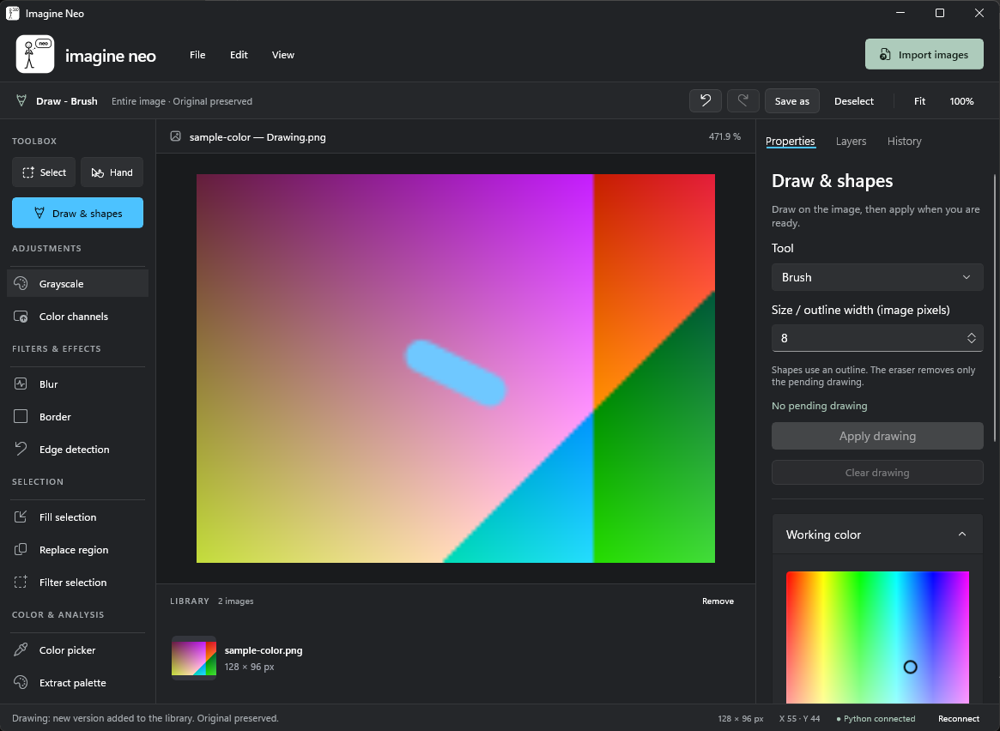

# Imagine Neo

**A Windows image editor with Python / OpenCV plugins and a native WinUI 3 interface.**
C# and Win2D handle the workspace; a persistent Python backend processes NumPy images locally through Windows shared memory.

[Interactive demo](https://professor-kaiser.github.io/imagine-neo/) · [Français](README.md) · [Plugin guide](docs/PLUGINS.md)



## Features and current status

Import images, work with rectangular selections, rotate and resize, draw and apply shapes,
compare image versions, undo/redo and export PNG or JPEG.
Grayscale, Gaussian / Average / Median blur, borders and Canny contours have implementations.
YAML plugins add denoising, Laplacian, morphology and mask generation, including HSV ranges and painted masks.

This is a **development preview**. Bilateral blur, channel separation, color picking, palette extraction
and the generic selection filter remain incomplete. Segmentation has known validation failures.
See [validation status](docs/STATUS.md). History lives for the current session; full project saving is not available.

## Try the demo

[Open the before/after comparison](https://professor-kaiser.github.io/imagine-neo/#demo).
It shows actual denoising plugin and grayscale outputs from a deterministic synthetic image.
Results are precomputed; the desktop editor runs on Windows.

Download [the sample PNG](docs/site/assets/original.png), import it in Imagine Neo,
choose the denoising plugin and click **Apply**. The source document remains available for comparison.

## Build and run

Requirements: **Windows 11 x64**, Git, **.NET 8 SDK x64**, and [Miniforge](https://github.com/conda-forge/miniforge#install).
Python 3.12, NumPy 2.2, OpenCV 4.12 and pywin32 are installed from the committed Conda environment.
Use **CMD** with `git`, `dotnet` and `conda.bat` on PATH:

```cmd
git clone https://github.com/professor-kaiser/imagine-neo.git
cd imagine-neo
scripts\setup_conda.cmd
scripts\run_all.cmd
```

If Conda is not found, set `PHOTOLAB_CONDA` to your actual `condabin\conda.bat` path.
Use `scripts\run_all.cmd Release` for a Release build.
Keep the entire output directory; the Windows App SDK is deployed beside the executable.

## Extend and verify

New processing features belong in `plugins/`: an `ImagePlugin` subclass, a child YAML,
and its folder in `plugins/plugins.yaml`. The common UI reads parameters from the catalogue.
See [the denoising example](plugins/denoise/plugin.py) and [contribution guide](CONTRIBUTING.md).

```cmd
scripts\test_backend.cmd
scripts\build_ui.cmd
scripts\test_interop.cmd
scripts\test_ui.cmd Debug run_all
```

The complete backend suite has known failures. The publication workflow verifies demo assets and the
processing used by the demo; it does not certify the whole desktop editor.
See [STATUS.md](docs/STATUS.md) for the exact baseline.

Keywords: Windows image editor, image processing, OpenCV, Python, WinUI 3, Win2D,
NumPy, computer vision, denoising, segmentation, masks, C#, YAML plugins.

Licensed under [MIT](LICENSE).
