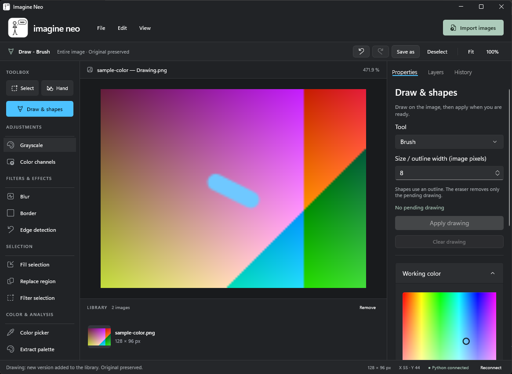
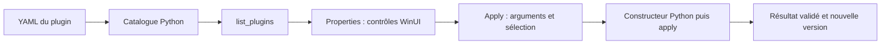

# Imagine Neo

**Un éditeur d’images Windows pensé pour les plugins Python et OpenCV.**

Imagine Neo réunit un atelier natif **C# / WinUI 3**, un canvas **Win2D** et un moteur **Python / NumPy / OpenCV**.
Importez une image, choisissez une zone, appliquez un traitement et comparez le résultat à l’original.
Pour créer votre propre outil, ajoutez une classe Python et un fichier YAML : l’interface construit ses paramètres.

[](https://github.com/professor-kaiser/imagine-neo/actions/workflows/publication.yml)
[](LICENSE)
[](https://professor-kaiser.github.io/imagine-neo/)

[Démo interactive](https://professor-kaiser.github.io/imagine-neo/) · [English](README.en.md) · [Guide des plugins](docs/PLUGINS.md) · [Backend](backend/README.md) · [Documentation technique](FURTHER/README.md)



## Pourquoi Imagine Neo ?

- **Pour explorer le traitement d’image** : visualisez les résultats OpenCV dans un atelier avec sélection, masques et versions.
- **Pour écrire vos propres filtres** : Python décrit l’algorithme ; le YAML déclare le nom, la classe et les contrôles.
- **Pour travailler localement** : l’application traite vos pixels sur votre PC ; ses commandes ne transmettent pas vos images à un service distant.
- **Pour comparer et expérimenter** : l’original reste disponible, les résultats ont leur miniature et l’historique permet de revenir en arrière.

Le projet s’adresse aux utilisateurs qui veulent expérimenter avec leurs images, aux étudiants en vision par ordinateur
et aux développeurs qui veulent ajouter des traitements sans créer un formulaire WinUI pour chacun.

**Préversion en développement.** L’installation actuelle se fait depuis les sources.
Les fonctionnalités et les limites connues sont présentées ci-dessous ; les détails de validation figurent dans [STATUS.md](docs/STATUS.md).

## Dans ce README

- [Fonctionnalités](#fonctionnalités)
- [Démo et première utilisation](#démo-et-première-utilisation)
- [Installation complète sur un nouveau PC](#installation-depuis-les-sources)
- [Créer un plugin de bout en bout](#créer-un-plugin-de-bout-en-bout)
- [Liaison YAML → contrôles WinUI → Python](#liaison-yaml--contrôles-winui--python)
- [Images, sélection, masques et résultats](#images-sélection-masques-et-résultats)
- [Mettre à jour et résoudre les problèmes](#mettre-à-jour-et-résoudre-les-problèmes)
- [Documentation et contribution](#documentation-et-contribution)

## Fonctionnalités

| Dans l’atelier | Ce que vous pouvez faire |
| --- | --- |
| Images | Importer plusieurs images, les déposer dans l’atelier, zoomer et déplacer la vue |
| Sélection | Tracer, déplacer et redimensionner une région rectangulaire |
| Transformations | Prévisualiser et appliquer rotation et mise à l’échelle |
| Filtres | Niveaux de gris, flous Gaussian / Average / Median, bordures et contours Canny |
| Dessin | Pinceau, gomme du dessin en attente, rectangles, cercles, lignes et flèches |
| Plugins | Débruitage, Laplacien, morphologie et traitements ajoutés par YAML |
| Masques | Canaux, seuils HSV, peinture, sélection des masques envoyés à un plugin |
| Versions | Comparer avec l’original, Undo / Redo et export PNG ou JPEG |

La segmentation est présente mais possède des échecs de validation connus.
Le flou bilatéral, la séparation des canaux, la pipette, l’extraction de palette et le helper générique de filtre sur sélection restent incomplets.
L’historique et les masques durent pendant la session ; **Save as** exporte une image, pas un projet complet.
Les images sont en BGRA8 ; l’édition HDR / 16 bits et une sauvegarde complète de projet ne sont pas proposées.

## Démo et première utilisation

La [démo avant/après](https://professor-kaiser.github.io/imagine-neo/#demo) montre le débruitage et les niveaux de gris
calculés par le code du projet sur une scène synthétique reproductible. Le navigateur affiche des résultats précalculés ;
l’éditeur complet s’exécute sur Windows.

1. Installez et lancez Imagine Neo avec les étapes ci-dessous.
2. Téléchargez [l’image de démonstration](docs/site/assets/original.png), puis cliquez sur **Import images**.
3. Choisissez **Débruitage** dans le catalogue des plugins ; ses réglages apparaissent dans **Properties**.
4. Cliquez sur **Apply**. Une nouvelle image apparaît dans la bibliothèque ; cliquez sur l’original pour comparer.
5. Essayez une sélection rectangulaire ou un masque, puis exportez le résultat avec **Save as**.

Raccourcis utiles : **Ctrl+O** importer, **Ctrl+S** exporter, **Ctrl+Z** annuler,
**Ctrl+Y** rétablir, **Ctrl+D** désélectionner, **Ctrl+0** ajuster la vue et **Ctrl+1** afficher à 100 %.
L’interface de l’application est principalement en anglais ; les noms de plugins suivent leur YAML.

## Installation depuis les sources

### 1. Installer les outils nécessaires

Sur un **nouveau PC Windows 11 x64**, installez ces trois outils avant de cloner le projet :

| Outil | Pourquoi il est nécessaire | Installation manuelle |
| --- | --- | --- |
| Git | Télécharger le dépôt et ses mises à jour | [Git for Windows](https://gitforwindows.org/) |
| **SDK .NET 8 x64** | Compiler l’interface C# ; le SDK fournit aussi le runtime .NET | [.NET 8 SDK pour Windows](https://dotnet.microsoft.com/download/dotnet/8.0) |
| Miniforge3 | Fournir Conda, qui installe l’environnement Python du projet | [Miniforge, installateur Windows x86_64](https://github.com/conda-forge/miniforge#install) |

Avec **Winget**, ouvrez PowerShell et exécutez :

```powershell
winget install --id Git.Git --exact
winget install --id Microsoft.DotNet.SDK.8 --exact --architecture x64
winget install --id CondaForge.Miniforge3 --exact --architecture x64
```

Si `winget` est introuvable, utilisez les installateurs manuels du tableau.
Installez le **SDK** .NET, pas seulement son runtime.
Après l’installation, fermez les anciens terminaux et ouvrez **Miniforge Prompt** depuis le menu Démarrer.
Ce terminal utilise CMD et rend Conda disponible sans devoir l’ajouter manuellement au PATH.

Vérifiez les outils :

```cmd
git --version
dotnet --list-sdks
conda --version
```

La liste des SDK doit inclure une version **8.0.x**.
Une connexion Internet est nécessaire pour télécharger les dépendances initiales Conda et NuGet.

### 2. Télécharger Imagine Neo et installer ses dépendances

Dans **Miniforge Prompt** :

```cmd
git clone https://github.com/professor-kaiser/imagine-neo.git
cd imagine-neo
scripts\setup_conda.cmd
```

`setup_conda.cmd` crée ou met à jour l’environnement Conda **photolab**, d’après
[backend/environment.yml](backend/environment.yml) :

| Dépendance installée par le script | Usage |
| --- | --- |
| Python 3.12 | Moteur et plugins |
| NumPy 2.2 | Tableaux de pixels |
| OpenCV 4.12 | Algorithmes de traitement d’image |
| pywin32 311 | Communication locale avec Windows |
| PyYAML 6.0 | Catalogue et paramètres des plugins |
| pytest 8.4 et jsonschema 4.25 | Vérifications du backend et du contrat |

Il n’est pas nécessaire d’installer un autre Python, de créer un `venv` ou d’exécuter `pip install` pour ce parcours.

### 3. Compiler et lancer l’application

Toujours à la racine du dépôt :

```cmd
scripts\run_all.cmd
```

Ce script compile C#, restaure les packages NuGet, vérifie le catalogue des plugins,
démarre un backend Python à jour et ouvre Imagine Neo.
**Visual Studio n’est pas nécessaire pour la configuration C# actuelle.**
Les outils Windows SDK utilisés par cette compilation sont restaurés par NuGet.

Le runtime **Windows App SDK** est déployé à côté de l’exécutable.
Si vous copiez une compilation, conservez son dossier entier ; le runtime .NET 8 et
l’environnement Python restent nécessaires. La [release actuelle](https://github.com/professor-kaiser/imagine-neo/releases)
distribue les sources et une image d’exemple, sans installateur autonome.

Autres modes :

```cmd
scripts\run_all.cmd Release
scripts\run_all.cmd Debug --no-build
scripts\run_all.cmd Debug --check
```

`--no-build` utilise une compilation existante ; `--check` compile et vérifie le catalogue sans ouvrir l’interface.
Conservez les noms techniques `photolab`, `PhotoLab.UI` et `PHOTOLAB_*` : ils font partie des scripts existants.

## Créer un plugin de bout en bout

Ce tutoriel ajoute **Teinte personnalisée**, avec une palette couleur et un réglage d’intensité.
L’exemple complet se trouve dans [docs/examples/tint/](docs/examples/tint/plugin.py).
Il est fourni pour être copié ; il ne figure pas par défaut dans le catalogue de l’application.

### 1. Créer le dossier Python

Créez cette structure sous la racine du dépôt :

```text
plugins/
  plugins.yaml
  tint/
    plugin.py
    plugins.yaml
```

Dans `plugins/tint/plugin.py`, placez :

```python
"""Example tint plugin: mix a color while preserving source alpha."""
import numpy as np
from app.plugins import (
    ImagePlugin, validate_bgra, validate_image_selection, apply_masked_result,
)


class TintPlugin(ImagePlugin):
    def __init__(self, color: list[int], amount: float):
        self.color = validate_bgra(color)
        if not 0.0 <= amount <= 1.0:
            raise ValueError("amount must be between 0 and 1")
        self.amount = amount

    def apply(self, image, selection, masks):
        validate_image_selection(image, selection, masks)
        result = image.copy()
        weight = self.amount * self.color[3] / 255.0
        mixed = (
            image[:, :, :3].astype(np.float32) * (1.0 - weight)
            + np.array(self.color[:3], dtype=np.float32) * weight
        )
        result[:, :, :3] = np.clip(np.rint(mixed), 0, 255).astype(np.uint8)
        return apply_masked_result(image, result, selection, masks)
```

Le plugin valide les entrées, calcule une teinte et conserve le canal alpha de l’image.
L’alpha de la couleur choisie règle la force du mélange ; il ne remplace pas l’alpha de l’image.
Le helper `apply_masked_result` limite le résultat à la sélection et aux masques choisis.

### 2. Déclarer la classe et ses paramètres

Dans `plugins/tint/plugins.yaml` :

```yaml
version: 1
plugins:
  - id: tint
    name: Teinte personnalisée
    description: Mélange une couleur avec l'image, en conservant son alpha.
    file: plugin.py
    class: TintPlugin
    output_kind: image
    parameters:
      color:
        type: color_bgra
        label: Couleur de teinte
        default: [0, 0, 255, 128]
      amount:
        type: number
        label: Intensité
        description: 0 conserve l'image ; 1 utilise toute la force de la couleur.
        default: 0.4
        min: 0
        max: 1
```

- `file` est relatif au dossier du YAML enfant.
- `class` nomme la classe dérivée de `ImagePlugin`.
- `id` est unique ; `name` et `description` décrivent l’outil visible dans l’application.
- `parameters` correspond exactement aux arguments de `__init__`.
- Les valeurs par défaut et bornes sont validées côté Python comme côté interface.

### 3. Enregistrer le dossier dans le catalogue principal

Dans [plugins/plugins.yaml](plugins/plugins.yaml), **ajoutez `- tint` à la liste existante** :

```yaml
version: 1
plugins:
  - laplacian
  - denoise
  - masks
  - segmentation
  - morphological
  - paint_mask
  - tint
```

Vous pouvez aussi copier les fichiers d’exemple depuis CMD, à la racine :

```cmd
mkdir plugins\tint
copy docs\examples\tint\plugin.py plugins\tint\plugin.py
copy docs\examples\tint\plugins.yaml plugins\tint\plugins.yaml
```

### 4. Vérifier, recharger et essayer

```cmd
conda activate photolab
cd backend
python -m app.check_plugins
cd ..
scripts\run_all.cmd Debug --no-build
```

Utilisez `--no-build` après avoir compilé l’application au moins une fois.
Si elle est déjà ouverte, **Reconnect** recharge le catalogue Python/YAML et restaure les documents de la session.
La modification d’un plugin Python/YAML ne nécessite pas de recompilation C#.

Importez une image, choisissez **Teinte personnalisée** :
**Couleur de teinte** affiche une palette avec alpha, **Intensité** un champ numérique.
Cliquez sur **Apply** pour obtenir une version dérivée, puis vérifiez une sélection et un masque.
Le [guide des plugins](docs/PLUGINS.md) détaille les erreurs, les sorties multiples et les générateurs de masques.

## Liaison YAML → contrôles WinUI → Python

**Le type YAML choisit le contrôle ; le nom du paramètre choisit l’argument Python.**
Un nom comme `color`, `tint` ou `couleur` n’active pas une palette par lui-même.

| Type YAML | Contrôle commun dans WinUI | Valeur reçue dans `__init__` |
| --- | --- | --- |
| `text` | Champ texte | `str` |
| `text` + `choices` | Liste déroulante | `str` appartenant aux choix |
| `integer` | Champ numérique entier | `int` |
| `number` | Champ numérique décimal | `float` |
| `boolean` | Case à cocher | `bool` |
| `color_bgra` | Palette couleur, alpha et champs B/G/R/A | `list[int]` : **[B, G, R, A]**, chaque canal 0–255 |
| `color_hsv` ou `hsv` | Roue teinte/saturation, luminosité et champs H/S/V | `list[int]` : **[H, S, V]**, H 0–179, S/V 0–255 |
| `integer` + `palette_channel` | Barre colorée liée à un autre choix de canal | `int`, borné de 0 à 255 |

Le type pris en charge pour la palette avec transparence est **`color_bgra`**.
`color_rgba` n’est pas un type YAML accepté actuellement. Si votre algorithme attend RGBA, convertissez explicitement :

```python
b, g, r, a = self.color
rgba = (r, g, b, a)
```

Une teinte rouge à demi-opacité s’écrit `[0, 0, 255, 128]` en BGRA.
La roue HSV suit les plages **OpenCV**, pas une teinte en degrés de 0 à 360.

Le parcours commun d’un plugin :



1. Le catalogue vérifie les fichiers, la classe, ses signatures et les valeurs YAML.
2. `list_plugins` transmet les descriptions à WinUI.
3. Le panneau **Properties** construit les contrôles communs et leurs valeurs par défaut.
4. **Apply** envoie `plugin_id` et `arguments` ; les pixels et masques utilisent la mémoire partagée.
5. Le moteur instancie la classe avec `TintPlugin(color=..., amount=...)`, puis appelle `apply(image, selection, masks)`.
6. Les résultats validés deviennent des images distinctes dans la bibliothèque et l’historique.

Il n’y a **aucun bouton, formulaire ou dispatch spécifique au nouveau plugin à ajouter dans WinUI**.
Si un nouveau type de paramètre devient nécessaire, étendez les abstractions communes.
Les fichiers responsables de ce parcours sont présentés dans le [README du backend](backend/README.md).

## Images, sélection, masques et résultats

| Entrée ou retour | Contrat |
| --- | --- |
| `image` | Image entière NumPy `uint8`, forme `(H, W, 4)`, canaux BGRA, alpha droit |
| `selection` | `Rect(x, y, width, height)` ou `None` ; coordonnées de l’image |
| `masks` | Liste de masques OpenCV `uint8`, forme `(H, W)`, mêmes dimensions que l’image |
| Retour de `apply` | Image BGRA ou liste non vide de 1 à 64 images BGRA |

Les masques sont transmis dans une enveloppe BGRA sur le transport, puis décodés en **un canal** avant l’appel Python.
Noir exclut un pixel ; toute valeur non nulle peut l’activer.
Le helper `apply_masked_result` utilise l’union des masques, intersectée avec la sélection ;
un plugin peut choisir une autre combinaison et doit l’expliquer.

Le moteur fournit des copies indépendantes, conserve l’original et protège les pixels hors sélection
pour les résultats de mêmes dimensions. Une sortie de taille différente est une image indépendante.
Les résultats multiples ne sont pas superposés et le lot est validé avant publication.
Limites : 32 768 pixels par côté et 512 Mio par image ; registre de session limité à 1 Gio / 128 images.

## Mettre à jour et résoudre les problèmes

Après une mise à jour du dépôt, à la racine :

```cmd
git pull --ff-only
scripts\setup_conda.cmd
scripts\run_all.cmd
```

| Problème | Action |
| --- | --- |
| `dotnet` est introuvable ou SDK 8 absent | Installez le SDK .NET 8 x64, puis ouvrez un nouveau terminal |
| Conda est introuvable | Utilisez Miniforge Prompt ou indiquez `PHOTOLAB_CONDA` ci-dessous |
| Le plugin n’apparaît pas | Vérifiez les deux YAML, les noms du constructeur et `python -m app.check_plugins`, puis **Reconnect** |
| La compilation ne peut pas remplacer un fichier | Fermez la fenêtre Imagine Neo avant de reconstruire |
| Les changements Python ne sont pas visibles | Rechargez avec **Reconnect** ou relancez l’application |
| **Coming soon** | L’outil concerné possède encore une implémentation incomplète |
| Une couleur est incorrecte | Vérifiez l’ordre BGRA ou les plages HSV OpenCV |

Si nécessaire, renseignez **votre chemin réel** depuis CMD :

```cmd
set "PHOTOLAB_CONDA=C:\chemin\vers\miniforge3\condabin\conda.bat"
scripts\setup_conda.cmd
scripts\run_all.cmd
```

Pour arrêter l’application, fermez sa fenêtre. Un backend lancé manuellement dans un autre terminal
s’arrête depuis ce terminal ; le lanceur complet gère le backend qu’il a créé.

## Documentation et contribution

| Vous cherchez… | Documentation |
| --- | --- |
| Le contrat complet et les paramètres des plugins | [docs/PLUGINS.md](docs/PLUGINS.md) |
| Le moteur Python et le trajet jusqu’au front | [backend/README.md](backend/README.md) |
| L’architecture, l’IPC, les tests et la maintenance | [FURTHER/README.md](FURTHER/README.md) |
| L’état réel des vérifications | [docs/STATUS.md](docs/STATUS.md) |
| Le site public et le référencement Google | [docs/PUBLICATION.md](docs/PUBLICATION.md) |
| Les règles de contribution | [CONTRIBUTING.md](CONTRIBUTING.md) |

Vous pouvez proposer un plugin, améliorer une doc ou partager un cas reproductible dans les
[issues](https://github.com/professor-kaiser/imagine-neo/issues).
Avant une contribution, vérifiez les scripts adaptés à votre changement.
Le workflow de publication vérifie la démo, les exemples et les liens ; la suite complète possède des échecs connus décrits dans STATUS.md.

Pour soutenir et suivre le projet : **Star** et **Watch** sur GitHub.
Mots-clés : éditeur d’images Windows, plugins Python, OpenCV, WinUI 3, image processing,
computer vision, denoising, image masks, segmentation, NumPy, C#.

Publié sous [licence MIT](LICENSE).
