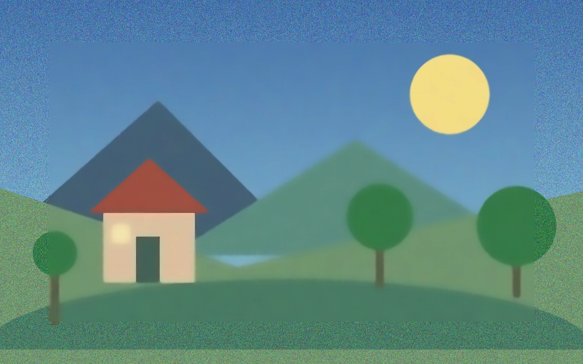

# Imagine Neo

**Éditeur d’images pour Windows 11, extensible avec des plugins Python et OpenCV.**
Interface native C# / WinUI 3, rendu Win2D, traitement local NumPy et mémoire partagée.

[Démo avant/après](https://professor-kaiser.github.io/imagine-neo/) · [English](README.en.md) · [Créer un plugin](docs/PLUGINS.md) · [Guide de développement](README_DEVELOPPEMENT.md)


## Ce que vous pouvez faire

- Importer plusieurs images, zoomer et sélectionner une région.
- Convertir en niveaux de gris, utiliser les filtres Gaussian / Average / Median, ajouter une bordure ou détecter des contours.
- Tourner et redimensionner une image avec un aperçu.
- Dessiner au pinceau, gommer le dessin en attente et tracer des formes.
- Créer des masques par canal, seuils HSV ou peinture ; choisir les masques transmis à chaque plugin.
- Utiliser les plugins de débruitage, Laplacien et morphologie. Un plugin de segmentation est aussi présent, avec des limites connues.
- Comparer l’original aux versions, utiliser Undo / Redo et exporter en PNG ou JPEG.

**Version en développement.** Le filtre bilatéral, la séparation des canaux, la pipette, l’extraction de palette et le filtre générique sur sélection sont incomplets.
La segmentation possède des échecs de validation connus. Consultez [l’état des vérifications](docs/STATUS.md).
L’historique dure pendant la session ; la sauvegarde d’un projet complet n’est pas encore disponible.

## Démo

La [démo publique](https://professor-kaiser.github.io/imagine-neo/#demo) propose un comparateur interactif de débruitage et de niveaux de gris.
Les images sont produites par le code Python du projet à partir d’une scène synthétique reproductible.
Le comparateur affiche des résultats précalculés ; l’application complète s’exécute sur Windows.



Pour essayer dans l’application :

1. Téléchargez [l’image de démonstration](docs/site/assets/original.png).
2. Lancez Imagine Neo et cliquez sur **Import images**.
3. Choisissez **Débruitage**, puis **Apply**. Comparez la nouvelle version à l’original.
4. Essayez une sélection rectangulaire, puis exportez avec **Save as**.

## Installation depuis les sources

Prérequis : **Windows 11 x64**, **Git**, **SDK .NET 8 x64** et **Miniforge / Conda**.
Le projet cible `net8.0-windows10.0.22621.0`. L’environnement Python utilise **Python 3.12**, **NumPy 2.2** et **OpenCV 4.12**.

- [.NET 8 pour Windows](https://learn.microsoft.com/dotnet/core/install/windows)
- [Installation Miniforge](https://github.com/conda-forge/miniforge#install)

Ouvrez un terminal **CMD** où `git`, `dotnet` et `conda.bat` sont accessibles :

```cmd
git clone https://github.com/professor-kaiser/imagine-neo.git
cd imagine-neo
scripts\setup_conda.cmd
scripts\run_all.cmd
```

`setup_conda.cmd` crée ou met à jour l’environnement `photolab`.
`run_all.cmd` compile l’interface, vérifie les plugins et lance un backend Python à jour.
La première installation télécharge les dépendances Conda et NuGet.

Si Conda est introuvable, indiquez votre chemin réel avant de relancer :

```cmd
set "PHOTOLAB_CONDA=C:\chemin\vers\miniforge3\condabin\conda.bat"
scripts\setup_conda.cmd
scripts\run_all.cmd
```

Pour une compilation optimisée : `scripts\run_all.cmd Release`.
Le runtime Windows App SDK est fourni avec la compilation ; conservez tout le dossier de sortie.
Le SDK .NET installé fournit aussi le runtime .NET requis.

## Architecture et plugins

| Dossier | Rôle |
| --- | --- |
| `ui/` | Interface C# / WinUI 3, canvas Win2D, historique et import/export |
| `backend/` | Moteur Python, NumPy, OpenCV et serveur IPC Windows |
| `plugins/` | Traitements et générateurs de masques déclarés en YAML |
| `shared/contracts/` | Contrat JSON du transport |
| `docs/site/` | Site GitHub Pages et comparateur de démonstration |
| `scripts/` | Installation, lancement et vérifications |

Ajoutez un dossier sous `plugins/`, une classe dérivée de `app.plugins.ImagePlugin`,
son `plugins.yaml` enfant et son chemin dans `plugins/plugins.yaml`.
Les paramètres alimentent l’interface commune automatiquement.

`apply(image, selection, masks)` reçoit l’image BGRA entière, une sélection nullable et les masques OpenCV.
Le contrat actuel des masques est `uint8 (H, W)` ; les détails sont dans [PLUGINS.md](docs/PLUGINS.md).
Le retour est une image BGRA ou une liste non vide d’images. Le moteur isole l’original et valide les résultats.
Le [plugin denoise](plugins/denoise/plugin.py) sert d’exemple.

Les pixels sont traités localement. Le backend garde les documents en mémoire pendant la session.
Les fichiers importés restent intacts ; l’export crée un fichier choisi par l’utilisateur.

## Vérifier le projet

Depuis CMD à la racine :

```cmd
scripts\test_backend.cmd
scripts\build_ui.cmd
scripts\test_interop.cmd
scripts\test_ui.cmd Debug run_all
```

Pour régénérer la démo et contrôler le site :

```cmd
conda activate photolab
python scripts\build_demo.py
python scripts\verify_publication.py
```

La suite complète a actuellement des échecs connus ; les chiffres et leur portée figurent dans [STATUS.md](docs/STATUS.md).
Le workflow de publication vérifie les assets et les traitements utilisés dans la démo.
Il ne remplace pas la suite complète du backend.

## Contribuer et découvrir le projet

Consultez [CONTRIBUTING.md](CONTRIBUTING.md), le [guide de développement](README_DEVELOPPEMENT.md)
et les [issues GitHub](https://github.com/professor-kaiser/imagine-neo/issues).
Pour suivre le projet, ajoutez une étoile ou activez **Watch** sur GitHub.

Mots-clés : éditeur d’images Windows, traitement d’image Python, OpenCV, WinUI 3,
image editor, image processing, computer vision, denoising, segmentation, image masks, NumPy, C#, plugins.

Publié sous [licence MIT](LICENSE).
